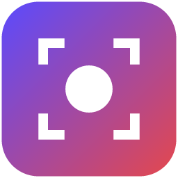

<p align="center"></p>

# Captode

Screenshots and screen recordings of the current tab, with an editor to mark them up and
export to the format you need. Captode runs entirely in your browser. Nothing is uploaded.

## Features

### Screenshots

- **Full page:** the whole scrolling page, stitched together. Fixed headers appear once. In
  web apps that scroll a panel rather than the window (mail, chat, documents, dashboards),
  that panel is captured at its full height.
- **Visible area:** what is on screen now.
- **Selected area:** drag out a rectangle.
- **Element:** point at a card, button or section and click; **↑** takes the larger area
  around it and **↓** goes back. One taller than the window is stitched together.
- **Delay:** wait 3, 5 or 10 seconds first, to open a menu or tooltip (for a selected area or
  an element, after choosing it). Esc cancels; if another tab is showing when the time is
  up, nothing is captured.
- **Right-click menu:** every kind of screenshot can also be started from the page's
  right-click menu, under Captode, or from the menu of Captode's toolbar icon.
- **Keyboard shortcuts** that work on any page: **Alt+Shift+F** full page, **Alt+Shift+V**
  visible area, **Alt+Shift+S** selected area. Element has none by default (Chrome allows
  an extension four suggested shortcuts); set or change any of them at
  `chrome://extensions/shortcuts`.

The capture opens in the editor, where you can:

- **Crop**, freely or to 1:1, 16:9, 4:3, 9:16 or 3:4. **Rotate** a quarter turn either way
  and **flip**, with your annotations following.
- **Draw** with a pen or highlighter.
- **Add shapes:** lines, arrows, rectangles and ellipses, with stroke colour, fill, thickness,
  opacity, and solid, dashed or dotted lines; arrows can have heads at both ends.
- **Callouts:** speech bubbles whose tail points at what you're talking about.
- **Spotlight** an area by dimming everything else, or **magnify** a detail with a lens.
- **Add text:** choose the font (including fonts installed on your computer), size (A− / A+),
  bold, italic, text colour and background colour.
- **Number the steps:** each click adds a numbered marker (1, 2, 3…) in the colour and
  size you choose; start from any number, or renumber one.
- **Blur, pixelate or black out** sensitive details. With **Blur private details** on in
  Settings (it is off at first), email addresses, phone numbers and card numbers in a new
  screenshot (in text or form fields) are blurred as it opens; each blur can be moved or
  removed, and Undo takes them all back. Dates, times, prices, years and order numbers are
  left alone. They are found on the page as it is captured; nothing is sent anywhere.
- **Copy text** (**X**) from a screenshot of a web page: drag over words to copy them, or
  click a line. The words are noted from the page as it's captured and kept with the
  screenshot on this device; they follow a crop or resize.
- **Your logo** in a corner, if you set one in Settings; turn it off for one screenshot in
  the Export tab.
- Select, move, resize (handles on every annotation), restyle and delete anything you
  added. **Select several** with Shift-click or by dragging a box, then move, restyle,
  duplicate, copy and paste (between editor tabs too), bring to front or send to back,
  **align** and **space evenly**. Moving and resizing **snap** to edges and centres, with
  guides (hold Alt to place freely). Undo and redo, or **Undo all** to go back to the
  original (itself undoable).
- **Your edits are kept** with the capture, so reopening it from Recent captures picks up
  where you left off.
- **Large captures stay fast:** the editor draws only what's on screen.
- **Pan** around a zoomed-in or long capture with the hand tool, by holding Space, or with
  the middle mouse button; ⌘/Ctrl + scroll zooms towards the pointer.
- **Resize** to exact pixel sizes, with or without keeping the proportions. Resizing keeps
  the original pixels: each new size is made from them, and **Original size** brings them
  back exactly, as sharp as they were.
- **Frame** the shot with padding, a backdrop colour, rounded corners and a shadow.
- **Smallest** saves the same pixels in the smallest file: Captode's optimised PNG or lossless
  WebP, whichever wins (PNG, for most screenshots). WebP has a **Lossless** switch, and when
  lossless WebP would be much smaller than the PNG you chose, the Export panel says so.
- **1× — as on screen** saves a screenshot from a Retina or scaled display at the page's own
  size. **Several sizes or formats** downloads each one ticked (say @1x and @2x, PNG and
  WebP) in one zip.
- **Set a size limit** (100 KB to 25 MB) and Captode keeps the text readable while it fits:
  first every pixel (the smaller lossless format, then the size the screenshot was on
  screen, for one from a high-resolution display), then a PNG with fewer colours that looks
  the same, then lossy at 75% quality or better. It never makes the image smaller than it was
  on screen. If no readable file fits, it says so and shows the smallest readable size;
  **Fit anyway** lowers quality and size until it fits, and **Keep it readable** goes back. **Auto** picks the fewest
  colours for PNG-8 and GIF that still look right. GIF has **lossy compression** too.
- **Export** as PNG, compressed 8-bit PNG, JPEG, WebP, GIF, BMP or PDF (one page, or A4 or
  Letter pages with long pages split across them). The quality and size controls compress the
  file, and the Download button shows the file's size before you download. You can also copy the
  image to the clipboard from the top bar, or have every new screenshot copied
  automatically (Settings → Copy screenshots to the clipboard). See [How compression works](#how-compression-works).
- **Quick styles:** Bug, Review, Note, Approved, Neutral and Brand set the colours of every
  tool at once, and of whatever is selected.
- **Presets** for common uses (chat, issue trackers, email, design review, phone mock-ups,
  websites), or save your own. Your last format and options are remembered.
- **Several devices at once:** one zip with an image for each device you tick.
- **Share for review:** a single web page with the annotated image, a note for each numbered
  step and where the capture came from, to attach to a ticket or send in chat. It opens in any
  browser, needs no account, and nothing is uploaded.
- **Keyboard shortcuts** for every tool. Press **?** in the editor to see them all.
- **Keyboard and screen readers:** every annotation is listed in words in the Annotate tab,
  where it can be chosen, moved, edited or removed from the keyboard, and changes are announced.
- **Undo** for removing a capture, deleting annotations, clearing measurements, deleting a
  preset and resetting settings.
- **Recent captures:** the popup shows the last three, and the editor every capture from the
  time chosen in Settings (a day at first), even after closing its tab.
- **Finding your way:** each tool's tooltip names its group and key and says what it does; a
  first image shows a short hint; and the editor opens with the tab and tool you used last
  (Crop and the hand excepted).
- **Popup:** the recording options fold into one line, the mode you used last is marked and
  **Enter** repeats it, and on pages Chrome protects, one click switches to recording the screen.

### Review tools

For checking a build against its design, in the editor's **Review** tab (nothing here is exported):

- **Measure (U):** drag across the image. Sizes are in CSS pixels, using the capture's pixel
  ratio. Lines straighten and their ends snap to edges, so an element's size comes out exact.
- **Colour picker (I):** pick a text and a background colour to see their hex codes and WCAG
  contrast ratio, with AA and AAA results for normal and large text.
- **Spacing grid (G):** every 4, 8, 16 or 24 CSS pixels.
- **Compare:** two captures, or a capture and a design file, with a slider, side by side, as an
  overlay, or as a difference that highlights the changed pixels and says how many changed.
  Images of different widths (a 1× design and a 2× screenshot) are lined up automatically.
  **Compare the last two captures** sets up a before-and-after in one click.

### Recordings

- **Full screen:** your whole screen or any window.
- **Visible area:** the current tab.
- **Selected area:** drag a rectangle; only that part of the tab is recorded.

Tab recordings keep only the page: if DevTools shows it at a phone's size (device mode),
the black space around it is left out. **Video size** records the page as shown (the
default), scaled (50%, 75%, 150% or 200%), or at a standard resolution (480p to 4K,
measured on the shorter side so phone-shaped pages stay portrait).

**Microphone** adds your voice, mixed with the tab's or screen's sound if that is
recorded too. **Camera bubble** puts you in a round, mirrored picture in the bottom left
corner of the video; it keeps moving even while the page stands still. The first time you
turn either on, a Captode page asks Chrome for access once and shows a preview; both are
used only while recording.

You can pick the frame rate (15, 24, 30 or 60 fps), include audio, show clicks and keyboard
shortcuts in tab recordings (never ordinary typing, and nothing in password fields), and set a
countdown of up to 30 seconds (or none) to get ready; press Esc, or Cancel for full-screen recordings, to
call it off. To pause, right-click the Captode icon and choose **Pause recording** (or use
**Pause** on the screen recording page, or a shortcut you set for it); the video leaves the
pause out. To point something out, choose **Draw on the page** in the same menu (or set a
shortcut): draw with the mouse or a finger, and each stroke fades by itself; Esc stops. If
the browser closes or crashes mid-recording, the popup offers what was recorded next time.
Click the Captode icon (or press **Alt+Shift+R**) to stop. The recording then
opens in the video page, where you can:

- Trim on a timeline with thumbnails and the sound's waveform: drag across it to choose the
  part to keep, drag its edges, or play to a point and press **I** (start) or **O** (end).
  Pointing at it shows that moment's frame; a click moves the playhead and its knob scrubs. **Space** plays only the trimmed part; the arrow keys step frame by frame.
- **Slides** (or **S** at the playhead): title cards put into the recording at a moment you
  choose. The recording waits while a slide is on screen, then carries on from the same frame,
  with the sound kept in step. Each slide has a title, subtitle and description (a line each;
  `-` makes a bullet), a style (seven themes, or your own colours and font), a layout
  (centred, left, with a picture, or lower third), a background colour, gradient or image,
  and a logo in any corner. New slides take the last one's style, and your logo is
  remembered for the next recording. Drag a slide's marker under the timeline to move it;
  playback shows slides as the export will. Slides are kept with the recording.
- **Edit** the recording; playback and the preview show every change as the export will:
  - **Cut** (**X**) leaves a part out, picture and sound; playback jumps over it. Or press
    **⇧X** where a cut should start and again where it should end.
  - **Speed up** (**P**) plays a part 1.5×, 2×, 4× or 8× as fast, silent (a page loading,
    a form being filled in).
  - **Zoom** (**Z**) moves in on part of the picture and back out, smoothly. **Zoom in on
    clicks** adds one wherever you clicked in a tab recording (Captode notes where and when
    you click while it records a tab). **Show clicks** draws a ring at each of those clicks.
  - **Blur** (**B**) hides something private: blurred, pixelated or a black box, for a
    while or for the whole recording.
  - **Callout** (**C**): an arrow, box, label or spotlight, drawn on the picture.
  - **Caption** (**T**): words along the bottom for a while, in every export. **Download
    .srt** or **.vtt** saves all the captions as a subtitle file timed for the exported video.
    **Translate all captions** puts them in another language, with the translator built
    into the browser (recent Chrome), on the device; it isn't offered where there's none.

  Each is a bar above the timeline: drag it, or its ends; **Split** cuts the chosen one in two
  at the playhead. **⌘Z**/**Ctrl+Z** undoes, **Delete** removes the one chosen. Edits are kept with the recording.
- **Step-by-step guide** (for tab recordings with clicks): a step for each click, with the
  frame at that moment, a numbered ring where you clicked, and a note that starts as what you
  clicked ("Click “Save”"). Edit, reorder or remove steps, then download a single web page, a
  PDF, or Markdown with its pictures (a zip, for docs and wikis). **Copy** puts the whole
  guide, pictures and all, on the clipboard to paste into Google Docs, Notion, Confluence,
  Word or an email. Each picture's alternative text is its note, for screen readers.
  **Translate into…** translates the title and notes on the device, where the browser has
  a translator; Undo puts them back.
- **Callouts** include circles and numbered steps, drawn as the screenshot editor draws them,
  in the same colours.
- **Crop** the picture to the part that matters (free, 16:9, 4:3, 1:1 or 9:16).
- **Background:** the video on a colour or gradient, with padding, rounded corners and a
  shadow, at its own shape or 16:9, 4:3, 1:1 or 9:16 (a device frame, when on, takes its place).
- **Sound:** volume (up to 200%), a fade in and out, and parts muted, all heard as you play.
  **Cut silent parts** leaves out the pauses (each is a cut you can keep or delete).
- **Use for new recordings** (under Background and Sound): recordings made afterwards start
  with that background, or that volume and those fades.
- **Frame to editor** (or **F**): the frame on screen, at full size, opens in the editor to
  annotate, copy or save.
- For MP4 and WebM, the Export button shows the most the file can weigh; screen recordings
  usually come out well under it.
- Export as **MP4** (H.264, with AAC audio), **GIF**, **WebP** (animated) or **WebM** (VP9, with
  Opus audio). Exports run in the background and much faster than real time: a 20-second
  clip takes about 2 seconds. Trims are frame-accurate.
- Choose the resolution (original, 2160p down to 240p) and the frame rate.
- **Reduce file size losslessly** (GIF and WebP). Repeated frames are merged and only the
  pixels that change are stored; every frame looks exactly as it would without this.
  **Ignore flicker** (on by default) also treats changes too small to see (2 levels out
  of 255) as no change, which makes screen recordings much smaller. WebP can also use
  lossless frames.
- Set the MP4 or WebM quality, from visually lossless to smallest file.

### Device mode

Turn on **Device mode** in the popup, the editor or the video page to export a screenshot or
video inside a real phone or tablet: 63 devices, including iPhone 13 mini to iPhone 18 Pro Max
and the iPhone Duo, iPhone SE, iPad mini to iPad Pro 13″, Pixel 7 to Pixel 11 Pro XL and the
Pixel 11 Pro Fold, Galaxy S24 to S26 Ultra, Galaxy Z Flip and Fold (including the Fold8 and
Fold8 Ultra), and Pixel and Galaxy tablets. Sizes come from the manufacturers' published
specifications (see the sources in `src/lib/devices.js`).

Each device uses its published screen resolution, pixel density and body size, so its
proportions and bezels are real. The frame is sized around the capture, so the capture keeps
its exact pixels: a screenshot taken on a device, or in DevTools' device mode, fills its screen
pixel for pixel. You can choose:

- the device, or **Best match for the capture**, which picks the device whose screen the
  capture fits (the panel says which, and whether the pixels are kept exactly)
- portrait or landscape (the hardware turns; the status bar and home indicator stay upright),
  or the **Rotate** button to switch between them in one click
- the **safe area**: show its edges (the parts outside it are tinted, in the export too), or
  keep the page inside it, clear of the status bar, cut-out and home indicator, as apps and
  web pages are laid out by default. Insets are Apple's for iPhones and iPads, and the status
  and gesture bars for Android, with the camera cut-out on the left in landscape
- the size: the capture's own pixels (exact), or the device's screen resolution
- how the capture fits the screen
- the finish, padding, and a transparent, white or custom-colour background (the default is set in Settings)
- a status bar above or over the page, or none

### Languages

Captode follows Chrome's language: English, Spanish, Portuguese (Brazil), French, German,
Italian, Japanese, Korean and Simplified Chinese.

### Settings

Open **Settings** from the gear in the popup (or right-click the icon → Options) to choose:

- **Theme:** System (follows your browser and computer), Light or Dark.
- **Export background:** Transparent, White or a custom colour, used behind device frames
  and around padded screenshots. JPEG, BMP, PDF, MP4 and WebM can't be transparent, so
  they get white when Transparent is chosen.
- **Default formats** for screenshots and recordings (or the last one used, or **Smallest**
  for screenshots), and whether device frames are on.
- **Blur private details:** blur email addresses and phone and card numbers in new
  screenshots (off at first).
- **Clicking Captode's icon:** opens the menu (at first), or takes a screenshot straight
  away: the visible area, the full page, a selected area, an element, or the last kind used.
  The menu is then in the icon's right-click menu.
- **After a screenshot:** open it in the editor (at first), download it straight away, or
  copy it to the clipboard. Downloads and copies are made as the editor would (default
  format, device frame, blurs) by an editor working in a background tab, which closes
  itself; if a page can't take the copy, the editor comes forward and copies it.
- **Pages too long for one image** (full pages past about 32,000 pixels): cut off at the
  limit (at first), scaled down to fit, or split into several images, each in its own tab.
- **File names:** a pattern with `{title}`, `{site}`, `{date}` and `{time}`, with an example;
  the default is `captode-{title}-{date}-{time}`.
- **Recording:** frame rate, video size, countdown, sound, microphone, camera bubble, clicks
  and keys, and the same options as the popup's; plus **Stop recording after** a set time and
  **Highlight the cursor** (a soft circle that follows the mouse in tab recordings).
- **Captures and storage:** every capture on this device with its size, and whether it's
  kept or how old it is, to keep, save as a project, or delete (or delete all not kept), and **Open project**.
  Choose how long captures not kept stay (a day at first, or a week, a month, or until you
  delete them). A bar shows the space screenshots and recordings take. Once there are a few,
  search them by title, website or date, show only screenshots, recordings or those kept,
  or sort the largest first.
- **Export presets:** the presets saved in the editor, on the video page and in Slides, to
  rename, reorder or delete.
- **Back up settings:** save every setting, your logo and your presets in a file, and load it
  on another computer or browser, or share it with your team (with Undo). Captures aren't in it.
- **Find a setting:** links to each section at the top, and a search box that shows only the
  settings that match.
- **Your logo:** an image (PNG, JPEG, WebP or SVG) added to a corner of screenshots and
  recordings: the corner, size and opacity, and whether it's added to new screenshots and
  to recordings, with a preview. Each can still be turned off for one capture when saving it.

Settings also lists every keyboard shortcut (with a button to change them), has links to
help, problem reports and the privacy policy, a **Share Captode** button (the system's
share sheet, or the store link copied), **Copy diagnostics** (versions, operating system,
shortcuts, settings and the last error, without page addresses, to paste into a problem
report; nothing is sent), and a button that resets everything to the defaults. The popup's
share icon copies the store link.

On browser pages that Chrome protects (such as `chrome://` pages and the Web Store), the
popup explains that the page can't be captured and leaves full-screen recording available.

### How compression works

Everything runs in the browser; nothing is uploaded.

- **PNG** is always lossless. Captode checks a few encodings and keeps the smallest: a
  palette at 1, 2, 4 or 8 bits per pixel when the image has 256 colours or fewer, greyscale
  when there's no colour, no alpha channel when nothing is transparent, and the best
  filter for each row. Fully transparent pixels are stored as transparent black. oxipng
  then recompresses the result.
- **JPEG** uses MozJPEG, tuned so each file is at least as faithful (by PSNR) as Chrome's
  own encoder at the same quality setting: the setting means what it did, the file is
  smaller (27% on average in the tests).
- **PNG-8 and GIF** keep the exact colours when an image has few enough of them, so flat
  UI screenshots lose nothing. Otherwise a median-cut palette is refined with k-means and
  colours are matched by a perceptual distance. Dithering is serpentine Floyd–Steinberg
  at reduced strength, and leaves areas of exact palette colours clean.
- **Lossy GIF** lets a pixel take a slightly different colour when that continues a run
  the compressor already knows, the technique behind gifsicle's `--lossy`.
- **Animated GIF** uses one palette for the whole clip and stores only the pixels that
  change. Dithering uses an ordered pattern, which stays still from frame to frame so it
  doesn't count as motion.
- **Animated WebP** stores each frame lossy or lossless, whichever is smaller. Lossless
  frames can leave unchanged pixels transparent to show the frame below.
- **PDF** pages use lossless compression when that is smaller than JPEG, which is common
  for screenshots of text, or always when quality is set to 100%.
- **MP4 and WebM** are made with WebCodecs: the recording is decoded, each frame is drawn
  (in a device frame if chosen) and encoded again, then written to a new file. WebM keeps
  the original Opus audio as it is; MP4 converts it to AAC, or keeps it as Opus where the
  browser has no AAC encoder (Chrome on Linux). If the browser can't do this,
  Captode falls back to playing the clip through in real time.
- **Recordings** are made with settings for screen content (sharp text, enough bitrate that
  still areas don't shimmer, and a key frame every 2 seconds), which also keeps exports small.
- Encoding runs in background workers, so the editor and video page stay responsive. GIF
  exports spread colour mapping and compression across several CPU cores.

Colours stay true for design and UX reviews: video exports keep the recording's exact
colours and are tagged as sRGB, so QuickTime, browsers and chat apps show them the same
way, and image exports (PNG, JPEG, PDF) are tagged as sRGB too. Downloading the original
recording (WebM) also writes its colours into the file.


### Keeping your work

Captures are kept on your device for a day, or a week, a month or until you delete them, as
chosen in Settings → Captures and storage. **Keep** (the bookmark button in the editor, the
video page and Recent captures) keeps one until you remove it. **Save project** (beside it)
downloads a `.captode` file with the capture and everything made for it: annotations, a
recording's edits, slides, guide and captions. Open it from Settings → **Captures and
storage** (or the editor's Open) to carry on later, or on another computer or browser. That
section of Settings lists every capture with its size, to keep, save or delete.

### Exports in the background

On Chrome and Edge, **Add to queue** (beside Export on the video page) makes the export in the
background: close the page and it carries on, and several can wait their turn. The toolbar
badge shows the progress, then ✓; the files are in the popup (and the video page) to download
or **Share** to another app. Share is offered wherever the system's share sheet takes files.

## Supported platforms

Captode runs on **Windows, macOS, Linux and ChromeOS**, in Chrome 116 or later and other
Chromium browsers (Edge, Brave, Opera, Arc), and in **Firefox 140** or later. Firefox has
no tab capture, so there it records the screen or a window but not a single tab, and
offers no camera bubble, video sizes, step-by-step guides (they're made from a tab
recording's clicks), background export queue or translation (it has no built-in translator); everything else is the same. A Safari package is
built too (see [store/README.md](store/README.md)) but not yet tested. The automated tests
run in Chrome on Windows, macOS and Linux on every push, and in Firefox (a full-page
screenshot, the popup and every page), including captures at 125%, 150% and 200% display scale, touch
input and Windows high-contrast mode. [docs/TESTING.md](docs/TESTING.md) has the manual
checklist for what automation can't reach: recording (which needs a real click) and
Chromebooks.

Platform differences, all handled:

- Keyboard shortcuts show as the platform writes them: ⌘ and ⌥ on macOS, Ctrl and Alt
  elsewhere. The popup and Settings show the shortcut actually set in Chrome.
- On Linux, and on Windows without Media Foundation, Chrome has no AAC encoder, so MP4
  exports keep the recording's Opus audio.
- Touchscreens (Chromebooks, Windows tablets) can drag out a selected area.

## Install

Captode works in Chromium browsers: Chrome 116 or later, Edge, Brave, Opera and Arc.
MP4 export uses the H.264 encoder built into Chrome. On the rare system without one, Captode falls back to real-time export, which needs Chrome 126 or later.

### From source

1. Clone this repository.
2. Open `chrome://extensions` and turn on **Developer mode**.
3. Click **Load unpacked** and choose the `src` folder.

## Development

The extension is plain JavaScript modules with no build step. Its only third-party code is
two WebAssembly codecs in `src/vendor` (see [Credits](#credits)).

```
src/
  manifest.json
  background.js          service worker: captures, recording state, toolbar icon
  content/page.js        functions injected into the page (area and element pickers, scrolling, delays, clicks)
  popup/                 the toolbar popup
  settings/              the Settings page
  editor/                image editor; review-page.js builds the Share for review page
  compare/               compare two images
  video/                 recording preview and export
  recorder/offscreen.*   records the tab (offscreen document)
  recorder/screen.*      records the whole screen or a window
  lib/
    db.js                hands captures between pages through IndexedDB
    recorder.js          MediaRecorder wrapper, with cropping for selected-area recordings
    device.js            phone and tablet frames
    devices.js           the device catalogue: real resolutions, densities and sizes
    device-picker.js     the searchable device menu
    presets.js           export presets
    remember.js          remembers export choices
    srgb.js              marks exported images as sRGB
    video-colour.js      colour spaces for recordings and their exports
    zip.js               ZIP writer for several-device exports
    settings.js          user settings shared by every page
    theme.js             applies the Light, Dark or System theme
    gif.js               animated GIF encoder: frame diffing, lossy LZW
    gif-worker.js        GIF colour mapping and compression on a worker pool
    webp.js              animated WebP muxer
    quantize.js          colour reduction (exact, median cut + k-means) and dithering
    png.js               lossless PNG writer (palette, greyscale, adaptive filters)
    formats.js           every still format, Auto colours and size limits
    encoder.js           runs still-image encoding in a worker (encode-worker.js)
    wasm.js              loads oxipng and MozJPEG
    webm.js, mp4.js      WebM reader/writer and MP4 writer for WebCodecs export
    pool.js              a small worker pool
  video/export-worker.js decodes, draws and encodes video exports with WebCodecs
  vendor/                oxipng and MozJPEG, compiled to WebAssembly
test/
  *.test.mjs             browser tests (capture, encoders, video export, interface)
  bench.mjs              compression benchmark with stored baselines
tools/
  brand.mjs              makes every icon from the vector logo in store/brand/
  store-assets.mjs       makes the store screenshots and promo tiles from the real UI
  package.mjs            builds a package for each browser
  targets.mjs            what differs by browser: manifests, store links, protected pages
  lint-firefox.mjs       runs Mozilla's validator on the Firefox package
```

```bash
npm install       # test tools only: Puppeteer and its Chrome for Testing
npm test          # run the browser tests (npm test -- video runs only matching ones)
npm run bench     # compression benchmark; fails on a size or quality regression
npm run icons     # every icon size from store/brand/logo.svg and logo-small.svg
npm run store     # store screenshots and promo tiles in store/ (-- de for one language, -- all for every one)
npm run package   # build a package for each browser in dist/ (see Publishing)
npm run lint:firefox  # check the Firefox package with Mozilla's validator
npm run release   # set the version, test, build the packages, commit and tag (see Publishing)
```

The tests load the extension into Chrome and drive real captures, edits and exports
against a local test page. They check what the encoders promise: lossless output is
pixel-identical, JPEG is at least as faithful as Chrome's own at the same quality and no
larger, size limits are met, trims land on the right frame, and audio lasts as long as
the video. Set `CHROME_PATH` to use another Chrome. The Firefox test runs when Firefox for
Puppeteer is installed (`npx puppeteer browsers install firefox@stable`) or `FIREFOX_PATH`
is set, and is skipped otherwise. GitHub Actions runs the tests and the
benchmark on every push.

The logo is vector artwork in `store/brand/`: `logo.svg` (the full mark),
`logo-small.svg` (the window alone, for 16 and 32 px, where the brackets would be lost)
and `logo-reverse.svg` (white brackets, for the brand's violet backgrounds). The window
has a thin light outline so it stays visible on dark toolbars. Edit these, then run
`npm run icons` and `npm run store -- all`.

`npm run bench` compares sizes, PSNR and SSIM with `test/bench-baseline.json`, kept per
operating system. After an intended change, save new numbers with
`npm run bench -- --update`.

### Translations

Text lives in `src/_locales/<language>/messages.json` (Chrome's format). Pages keep their
English text in the HTML and mark it with `data-i18n` attributes, which `src/lib/i18n.js`
swaps for the browser's language; scripts use `t('key', values)`. After adding or changing a
message, add it to every language and run:

```
npm run i18n
```

It checks that every language has every message with the same `$1` placeholders and markup.
`test/i18n.test.mjs` opens every page in German and Japanese and fails if a message key, rather
than text, ever shows.

## Publishing

Make your changes, then run `npm run release -- patch --push --message="What changed"` (or
`minor`, `major`, or a version) without committing them first. It sets the version, checks
the translations, runs the tests, builds a package for each browser and checks the Firefox
one with Mozilla's validator; then it makes **one commit** ("Captode <version>", with your
description) holding your changes and the new version, tags it and pushes. The tag's GitHub
release gets the same packages. If a check fails, only the version number is put back and
your changes stay as they were. It refuses a version that isn't higher than the last tag
(stores only install higher versions); `--dry-run` shows what it would do and which files it
would include.

| Package in `dist/` | For |
| --- | --- |
| `captode-<version>-chrome.zip` | Chrome Web Store |
| `captode-<version>-edge.zip` | Microsoft Edge Add-ons |
| `captode-<version>-firefox.zip` and `-source.zip` | addons.mozilla.org |
| `captode-<version>-safari/` | Xcode's Safari web extension converter, then the App Store |

Each package has only its own browser's manifest and settings, made by
`tools/targets.mjs`; the build stops if one mentions another browser's store, ID or pages.
[`store/README.md`](store/README.md) has the steps for each store, and
[`store/listing.md`](store/listing.md) and
[`store/listing-firefox.md`](store/listing-firefox.md) every listing field ready to paste.

## Privacy

Captode does not collect, send or store anything outside your browser. See [PRIVACY.md](PRIVACY.md).

## Credits

Captode includes, compiled to WebAssembly from the [jSquash](https://github.com/jamsinclair/jSquash)
packages of Google's [Squoosh](https://github.com/GoogleChromeLabs/squoosh) codecs:

- [oxipng](https://github.com/shssoichiro/oxipng) (MIT) for lossless PNG recompression
- [MozJPEG](https://github.com/mozilla/mozjpeg) (IJG and BSD licences) for JPEG

This software is based in part on the work of the Independent JPEG Group. The licences
are in `src/vendor`.

## License

Captode is free software, and stays free: you can use it, share it and change it under the
[GNU General Public License](LICENSE), version 3 or (at your option) any later version.
Anyone who shares Captode or a version of it must share it under the same licence, with its
source code, so it can't be turned into a closed product. It comes with no warranty.

Copyright © 2026 Nevin Paul. Versions up to 1.5.3 were released under the MIT licence.

The bundled codecs keep their own licences (Apache-2.0, MIT and the IJG/BSD licence; see
[`src/vendor/README.md`](src/vendor/README.md)), all of which may be combined with the GPL.
